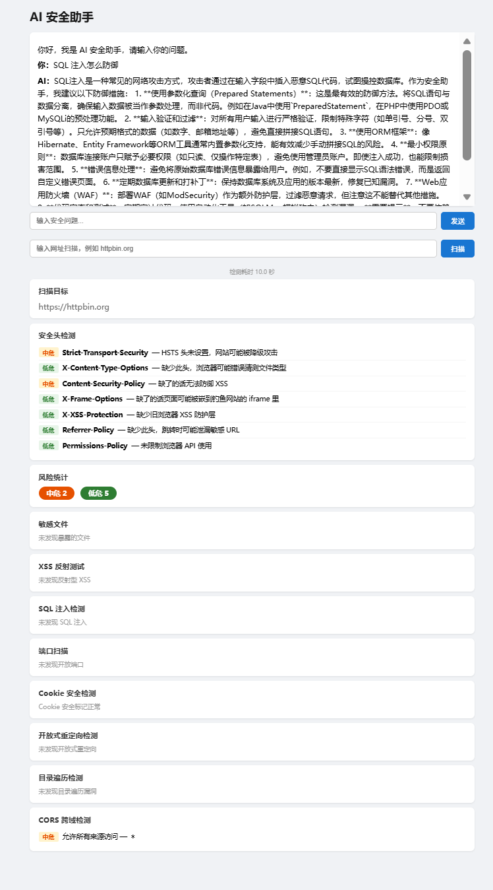

# AI 安全助手

[](https://github.com/Seefanc/ai-security-assistant/actions/workflows/ci.yml)

🔗 **在线体验**：https://ai-security-assistant-toi6.onrender.com/

当前版本 **v1.1.0**（线上已验证：10 个模块全部可用，扫描 example.com 约 5.6 秒）

输入一个网址，自动检测 10 类常见 Web 配置问题，并把结果整理成卡片 + 可下载的 JSON 报告；同时集成 DeepSeek 做安全问答。

## 功能

| 模块 | 检测内容 |
|------|----------|
| 安全响应头 | HSTS、CSP、X-Frame-Options、X-Content-Type-Options、Referrer-Policy、Permissions-Policy 缺失情况，并给出加固写法 |
| 敏感文件泄露 | `/.git/HEAD`、`/.env`、`/admin/` 是否可未授权读取（校验响应内容，避免 SPA 兜底页误报） |
| 反射型 XSS | 3 种 payload 是否被原样反射（仅对 HTML 响应判定） |
| SQL 注入 | 报错型注入：先用正常参数取基线，只有注入后才出现的数据库报错才算命中 |
| 开放端口 | 80/443/22/3306/8080 的 TCP 连通性 |
| Cookie 安全标记 | HttpOnly / Secure / SameSite 缺失，按每个 Set-Cookie 判断 |
| 开放式重定向 | `redirect`/`url`/`next`/`goto`/`return` 参数是否可跳转到外部域名 |
| 目录遍历 | 4 种穿越 payload，命中需匹配文件内容特征（如 passwd 的 `root:x:0:0` 结构） |
| CORS 配置 | 通配符放行、通配符 + 携带凭证、任意 Origin 反射 |
| 危险 HTTP 方法 | OPTIONS 的 `Allow` 中出现 PUT/DELETE/TRACE/PATCH |

## 架构

```
浏览器（原生 JS 单页）
   │  POST /api/scan {url}
   ▼
FastAPI（server.py）
   ├─ 目标校验 guard.py：协议/端口/内网地址（防 SSRF）
   ├─ 限流 ratelimit.py：每 IP 滑动窗口
   └─ asyncio.gather 并发调度 10 个模块，每个模块 10s 超时 + 错误隔离
         │  asyncio.to_thread
         ▼
      scanner.py：requests 会话（关闭自动跳转）+ 模块内并发探测
```

每个模块返回 `{status, items, error, elapsed_ms}`，`status` 取 `ok / timeout / error`。
前端据此区分「扫描完成且没发现问题」与「根本没扫成功」，避免把超时误读成安全。

## 安全设计（本项目自身的安全）

扫描器本身也是联网服务，所以额外做了这些：

- **防 SSRF**：所有出站请求前校验协议、端口和解析后的 IP，拒绝回环/私网/链路本地地址（含 `169.254.169.254` 云元数据），并关闭自动跟随跳转，防止用 302 把请求带到内网。
- **输出编码**：扫描结果里的所有外部数据（目标返回的 Location、页面内容、用户输入）进入 `innerHTML` 前统一 `esc()` 转义；CSS class 走白名单。这是「扫描器自身被目标站点反向注入」的修复。
- **限流**：扫描 6 次/分钟、问答 20 次/分钟（进程内滑动窗口），避免公开服务被当作免费扫描器/免费 LLM 代理。
- **密钥管理**：只从环境变量 `DEEPSEEK_API_KEY` 读取，`.env` 在 `.gitignore` 中，缺 key 时接口返回 503 而不是启动崩溃。
- **请求约束**：问答消息长度上限 2000、URL 上限 2048。

## 本地运行

```bash
pip install -r requirements.txt
cp .env.example .env        # 填入 DEEPSEEK_API_KEY
uvicorn server:app --reload
# 打开 http://127.0.0.1:8000/（会自动跳转到 /static/index.html）
```

没有 key 也能用扫描功能，只有 AI 问答会返回 503。

## API

### `POST /api/scan`

```json
{"url": "example.com"}
```

```json
{
  "target": "https://example.com/",
  "scanned_at": "2026-10-15T12:00:00+00:00",
  "elapsed_ms": 6034,
  "modules": {
    "headers": {"key": "headers", "title": "安全响应头", "status": "ok", "items": [], "error": null, "elapsed_ms": 1728},
    "ports": {"key": "ports", "title": "开放端口", "status": "timeout", "items": [], "error": "超过 10 秒未完成", "elapsed_ms": 10001}
  },
  "empty_text": {"headers": "安全响应头齐全", "ports": "常见端口均未开放"},
  "stats": {"medium": 2, "low": 4},
  "summary": {"ok": 9, "timeout": 1, "error": 0, "findings": 8}
}
```

非法目标（内网地址、非 http(s) 协议、非 Web 端口）返回 `400`；触发限流返回 `429` 并带 `Retry-After`。

### `POST /api/chat`

```json
{"message": "CSP 应该怎么配置？", "level": "normal"}
```

### `GET /api/health`

返回服务状态、版本、是否已配置 DeepSeek key。

## 性能

- 改造前：10 个模块串行，单次扫描 **51 秒**（测试目标 httpbin.org，本身响应偏慢）
- 改造后：`asyncio.to_thread` + `gather` 并发，同样目标 **11 秒**，约 **4.6 倍**
- 每个模块独立 10 秒超时 + 异常隔离，单模块失败不影响其它模块
- 以公开站点实测（example.com）：本机直连约 6 秒；线上 Render 免费实例约 **5.6 秒**（最慢的仍是端口模块）

> 说明：4.6 倍是相对 httpbin 这种慢站点测得；对响应快的站点，串行耗时本身就低，倍率会小一些。

## 测试

```bash
pip install -r requirements-dev.txt
python -m pytest -q
```

62 个用例，全部用假响应，不产生真实网络请求，覆盖：

- `guard.py`：协议/端口/私网/云元数据拦截，DNS 解析到内网时的拒绝
- 10 个检测模块的判定逻辑与误报回归（SPA 兜底页、基线报错、`localhost` 关键词等）
- 接口层：目标校验、模块错误隔离、超时语义、限流、问答参数校验

## 已知限制

- 只覆盖 Web **配置层面**的常见问题，不做业务逻辑漏洞（越权、支付逻辑绕过）检测。
- 基于公开 payload 与特征匹配，存在误报/漏报，**不能替代专业渗透测试**。
- 反射型 XSS 只判断「payload 是否原样出现」，不区分 HTML/JS 上下文，可能出现误报。
- 端口探测为 TCP 连通性，不识别服务指纹；CDN/负载均衡后面的站点结果参考价值有限。
- 超时线程无法被强制终止（Python 线程限制），极端情况下会短暂占用后台线程。
- Render 免费版闲置后会冷启动，首次访问约需 30-50 秒。
- 仅限扫描**你有权测试**的站点。

## 部署

仓库自带 `render.yaml`（Blueprint）：新建 Blueprint → 关联仓库 → 在控制台填入 `DEEPSEEK_API_KEY` 即可。

部署后用两个判据确认新版本真的生效（旧版本这两个都返回 404）：

```bash
curl -s https://<你的服务>.onrender.com/api/health   # 期望返回 {"status":"ok","version":"1.1.0",...}
curl -s -o /dev/null -w '%{http_code}\n' https://<你的服务>.onrender.com/   # 期望 307
```

渲染平台建议在 Settings → Build & Deploy 打开 **Auto-Deploy**，否则每次 `git push` 后都要手动点一次 Manual Deploy。

## 更新记录

**v1.1.0（2026-10）**

- 修复扫描接口的 SSRF 风险：新增目标校验，拒绝内网/回环/云元数据地址，关闭自动跳转绕过
- 新增每 IP 滑动窗口限流；问答消息与 URL 长度限制
- 修复检测误报：端口改 TCP 探测、Cookie 按 Set-Cookie 逐条判断、目录遍历改组合特征、SQL 注入加基线对比、移除 robots.txt 误报
- 模块结果改为 `{status, items, error}`，前端区分「未发现」与「超时/失败」
- 补充 62 个 pytest 用例与 GitHub Actions CI，依赖加上版本约束
- 新增 `GET /api/health`、根路径跳转、声明式部署配置

**v1.0.0（2026-06 ~ 2026-10）**

- 10 个检测模块、单页前端、DeepSeek 问答、asyncio 并发优化（51s → 11s）、Render 上线

## 截图

> 截图为 v1.0 界面；v1.1 在每个模块卡片右上角增加了「完成 / 超时 / 失败」状态标签与模块耗时。



## License

MIT
