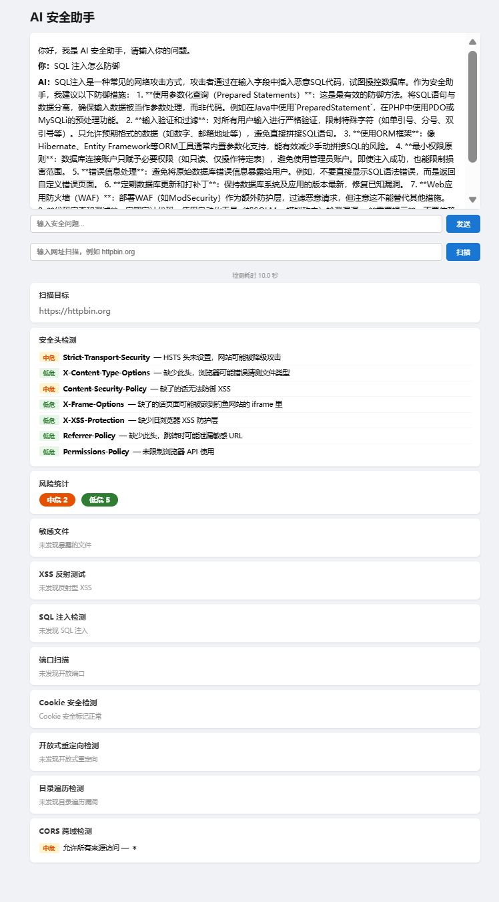

# AI安全助手

🔗 **在线体验**：https://ai-security-assistant-toi6.onrender.com/static/index.html

## 介绍
输入一个网址，自动检测 10 类常见 Web 安全配置问题，并用 AI 分析安全问题。

## 技术栈
后端 Python + FastAPI，前端 HTML + CSS + JavaScript，AI DeepSeek API，安全扫描 requests库

## 功能
- 安全头检测
- 敏感文件泄露检测
- XSS 漏洞检测
- SQL 注入检测
- 开放端口检测
- Cookie 安全检测
- 开放式重定向检测
- 目录遍历检测
- CORS 跨域检测
- HTTP 危险方法检测（PUT/DELETE）

## 运行方式
pip install -r requirements.txt  
uvicorn server:app --reload
打开 http://127.0.0.1:8000/static/index.html

## 截图
